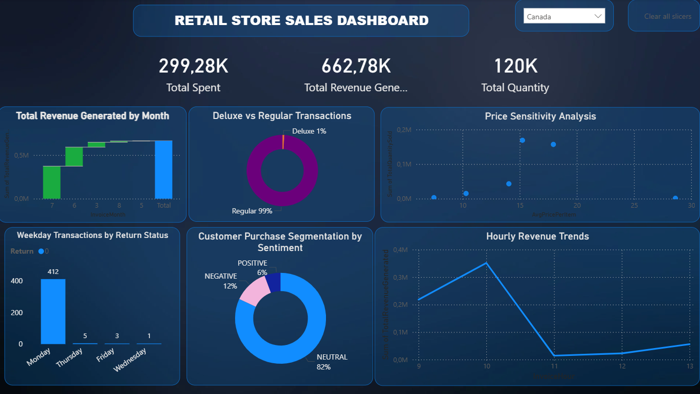

# 🛒 Online Retail II — CLV, Product Sentiment & Country Dashboards

## 📌 Project Summary
This project uses the **Kaggle Online Retail II** dataset to:
- Compute customer features (Recency, Frequency, Monetary) and predict CLV.
- Perform semantic clustering and sentiment analysis on product descriptions to label **deluxe** vs **non-deluxe** products.
- Provide interactive **Power BI dashboards** to explore sales and CLV trends — **changeable per country** (filter / slicer).

---

---

## 📊 Dashboards — Sales & CLV 
The Power BI dashboard contains interactive pages that let you:
- Filter sales and CLV metrics **by country** using the country slicer.
- Inspect **monthly revenue trends**, **cohort analysis**, and **customer segments** per selected country.
- Compare **deluxe vs non-deluxe** product clusters and their sales by country.
- View **top customers**, **CLV distribution**, and predicted vs actual CLV within a chosen country.

### 🖼 Dashboard Preview
Here is a snapshot of the interactive Power BI dashboard:

---

## 🎯 Customer Segmentation Report (to display verbatim in the dashboard)
You can paste the following summary into a dashboard text box or a `README / report` tile.

### Cluster Overview

| Cluster | Label | Characteristics |
|---------|-------|----------------|
| 0 | Occasional Buyers | Customers who buy frequently but prefer cheaper products. Lower engagement overall. |
| 1 | Premium Product Buyers | Customers who buy high-end or deluxe products but have low overall engagement and purchase frequency. |

### Cluster Insights & Marketing Advice

#### Cluster 0 — Occasional Buyers (Cheaper Products)
**Insights:**
- Lower total spending per transaction.  
- Purchase smaller, less expensive items.  
- Moderate engagement — they can become loyal if incentivized.  

**Marketing Advice:**
- 🛍️ Promote budget-friendly bundles or frequent deals.  
- 🎁 Introduce loyalty points to encourage repeat purchases.  
- 📅 Run campaigns highlighting affordable new arrivals or seasonal discounts.  
- 💌 Use reminders and newsletters to increase engagement.

#### Cluster 1 — Premium Product Buyers (Low Engagement)
**Insights:**
- Prefer high-end or deluxe products.  
- Low purchase frequency — engagement is limited.  
- High-value potential, but not regular shoppers.  

**Marketing Advice:**
- 🏆 Offer exclusive access to premium products or VIP events.  
- 🎯 Personalize recommendations based on previous deluxe purchases.  
- 💌 Send targeted campaigns to re-engage them, e.g., limited-time premium offers.  
- 📈 Encourage subscription models or high-value bundles to increase purchase frequency.

**Summary**
- **Cluster 0:** Focus on boosting engagement with affordable products.  
- **Cluster 1:** Focus on retention and re-engagement for high-value premium customers.  

---

